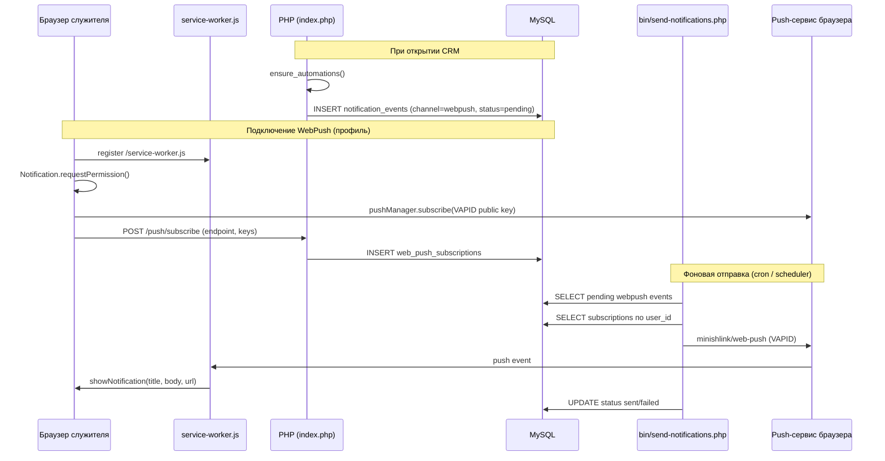

# WebPush-уведомления

WebPush в CRM Домашних групп — это браузерные push-уведомления для служителей (лидеров домашних групп и выше). Они дополняют задачи в интерфейсе и уведомления в Max/VK-ботах: напоминают о людях, которые давно не появлялись на встречах, даже когда вкладка CRM закрыта.

Подробнее о статусе реализации см. [implementation-status.md](implementation-status.md). Настройка cron на shared-хостинге — в [shared-hosting.md](shared-hosting.md).

## Зачем это нужно

Основной сценарий — **критичные напоминания «Радара заботы»**.

При каждом открытии приложения (для ролей выше участника) вызывается `ensure_automations()` в `src/bootstrap.php`. Функция анализирует людей в зоне видимости пользователя и:

1. создаёт пастырские **задачи** (новички, выпадение из общения);
2. при длительном отсутствии на встречах ставит **WebPush-событие** в очередь;
3. параллельно ставит аналогичное уведомление в **Max/VK-боты** через `queue_pastoral_bot_notification()`.

WebPush срабатывает, когда человек **не был больше 6 недель** (`attendanceDays > 42`). Для радара берётся более поздняя из дат: последнее присутствие на встрече (`present`/`new`) и `first_visit_date` — чтобы новичок с только что указанным первым посещением не получал ложное критичное напоминание:

| Поле события | Пример |
|---|---|
| `title` | Радар заботы |
| `body` | Иван Иванов не был больше 6 недель. Нужен пастырский контакт. |
| `url` | `/person?id=123` |

Получатель — **лидер домашней группы** (`leader_user_id` из карточки группы). Если лидер не привязан к учётной записи, событие уходит текущему пользователю.

**Дедупликация:** не чаще одного уведомления на пару «получатель + карточка человека» за 7 суток (проверка по `user_id`, `url` и `created_at` в `notification_events`).

Других источников WebPush-событий в коде сейчас нет: канал `webpush` в `notification_events` используется только для радара заботы.

## Как это устроено



### Компоненты

| Компонент | Назначение |
|---|---|
| `public/service-worker.js` | PWA-кэш статики; обработчики `push` и `notificationclick` |
| `public/assets/app.js` | Регистрация service worker; кнопка «Подключить WebPush» на `/profile` (Моя учетная запись) |
| `public/index.php` | `POST /push/subscribe` — сохранение подписки; `/security` — VAPID-ключи |
| `src/Features.php` | `webpush_config()`, `generate_vapid_keys()`, `normalize_vapid_subject()` |
| `src/bootstrap.php` | `ensure_automations()` — постановка событий; `data-vapid-public-key` в `<body>` |
| `bin/send-notifications.php` | CLI-отправщик очереди через библиотеку `minishlink/web-push` |
| `web_push_subscriptions` | Подписки браузеров (endpoint, p256dh, auth) |
| `notification_events` | Очередь исходящих уведомлений по каналам |
| `user_notification_settings` | Флаги `email_enabled` / `webpush_enabled` в профиле |

Service worker **не кэширует** HTML-страницы CRM — только статические assets (`app.css`, `app.js`, иконки, manifest). Это нужно, чтобы AJAX-навигация и персональные данные не отдавались из устаревшего offline-кэша.

## Подключение для служителя

1. Войти в CRM под учётной записью лидера или выше.
2. Открыть **Моя учетная запись** (`/profile`).
3. Убедиться, что включён чекбокс «WebPush-уведомления».
4. Нажать **«Подключить WebPush в браузере»** — браузер запросит разрешение на уведомления.
5. После успешной подписки кнопка меняется на «WebPush включен».

Требования:

- HTTPS (или `localhost` для разработки);
- поддержка `serviceWorker` и `PushManager`;
- задан публичный VAPID-ключ (см. ниже).

Без VAPID-ключей интерфейс сообщит, что WebPush подготовлен, но не активирован.

## Настройка VAPID-ключей

VAPID (Voluntary Application Server Identification) — пара ключей, с которой push-сервисы браузера (FCM, Mozilla и др.) принимают отправку от вашего сервера.

### Через интерфейс (рекомендуется)

1. Войти под суперадминистратором. Ключи общие для всех церквей, пастор и администратор церкви их не видят.
2. Открыть **Безопасность** (`/security`).
3. Нажать **«Сгенерировать ключи»** или вставить существующую пару вручную.
4. Указать **контакт отправителя** — рабочий email (`admin@церковь.ru`) или URL сайта (`https://сайт-церкви.ru`). Это не тема письма, а контакт владельца приложения по стандарту WebPush.
5. Сохранить настройки.

Ключи хранятся в таблице `app_settings` (`vapid_public_key`, `vapid_private_key`, `vapid_subject`). Закрытый ключ помечен как секрет.

**Важно:** после генерации новой пары старые подписки браузеров перестают работать — служителям нужно снова нажать «Подключить WebPush».

### Через config/local.php

Альтернатива для деплоя без UI или как fallback:

```php
'webpush' => [
    'public_key' => '...',
    'private_key' => '...',
    'subject' => 'mailto:crm@your-domain.ru',
],
```

Приоритет: значения из `app_settings` в БД перекрывают `config/local.php` (см. `webpush_config()` в `src/Features.php`).

## Фоновая отправка

События не уходят сразу при создании — их забирает CLI-скрипт:

```bash
php bin/send-notifications.php
```

В Docker Compose сервис `scheduler` запускает этот скрипт каждые 60 секунд вместе с email- и bot-отправщиками:

```bash
docker compose exec app php bin/send-notifications.php
```

На shared-хостинге добавьте cron (см. [shared-hosting.md](shared-hosting.md)):

```bash
* * * * * php /path/to/project/bin/send-notifications.php
```

Скрипт:

1. проверяет наличие VAPID-ключей и контакта отправителя (код выхода `2`, если не настроено);
2. проверяет наличие `minishlink/web-push` (код `3`, если не установлен `composer install`);
3. берёт до 50 событий `channel = webpush` и `status = pending`;
4. для каждого события находит все подписки пользователя в `web_push_subscriptions`;
5. отправляет JSON `{ title, body, url }` через Web Push API;
6. помечает событие `sent` или `failed` с текстом ошибки.

Если у пользователя нет активных подписок, событие получает `failed` с сообщением `No active WebPush subscriptions`.

## Поведение в браузере

При получении push service worker (`public/service-worker.js`):

1. разбирает JSON из тела push;
2. показывает системное уведомление с иконкой `/assets/icon-192.png`;
3. при клике открывает или фокусирует вкладку CRM и переходит по `url` из payload.

Публичный VAPID-ключ передаётся в HTML как `data-vapid-public-key` на `<body>` — клиент использует его в `pushManager.subscribe()`.

## Отличие от email и ботов

| Канал | Типичные события | Механизм |
|---|---|---|
| **WebPush** | Критичный радар: человек не был > 6 недель | `notification_events` → `bin/send-notifications.php` |
| **Email** | Сброс пароля, заявки участников, смена роли, создание группы | `email_notifications` → `bin/send-emails.php` |
| **Max/VK-боты** | Радар заботы, ежедневная сводка, быстрые действия | `notification_events` (telegram/vk/max) → `bin/send-bot-notifications.php` |

WebPush и боты получают одно и то же напоминание радара, но через разные каналы — служитель может выбрать удобный.

## Настройки пользователя

В профиле (`/profile`) сохраняются флаги `email_enabled` и `webpush_enabled` в `user_notification_settings`.

**Текущее ограничение:** отправщики `bin/send-notifications.php` и `bin/send-emails.php` пока **не проверяют** эти флаги — события ставятся и отправляются независимо от чекбоксов. Флаги заложены для будущей фильтрации; фактическая доставка WebPush зависит от наличия браузерной подписки и разрешения ОС на уведомления.

## Диагностика

| Симптом | Что проверить |
|---|---|
| Кнопка говорит, что VAPID не задан | `/security` или `webpush.*` в `config/local.php` |
| События в `failed`, «No active WebPush subscriptions» | Пользователь не нажал «Подключить WebPush» или подписка устарела после смены ключей |
| События в `pending`, уведомлений нет | Не запущен cron / scheduler; проверить `php bin/send-notifications.php` вручную |
| Скрипт завершается с кодом 3 | `composer install` в каталоге проекта |
| Уведомление не открывает карточку | Проверить `url` в `notification_events` и обработчик `notificationclick` в service worker |

Полезные SQL-запросы:

```sql
-- Очередь WebPush
SELECT id, user_id, title, status, error_message, created_at
FROM notification_events
WHERE channel = 'webpush'
ORDER BY id DESC
LIMIT 20;

-- Подписки пользователя
SELECT id, endpoint, last_seen_at, created_at
FROM web_push_subscriptions
WHERE user_id = ?;
```

После смены VAPID-ключей верните failed-события в очередь при необходимости:

```sql
UPDATE notification_events
SET status = 'pending', error_message = NULL
WHERE channel = 'webpush' AND status = 'failed';
```

## Безопасность

- `POST /push/subscribe` требует авторизации и CSRF-токен.
- Закрытый VAPID-ключ хранится как секрет в `app_settings`.
- Подписки привязаны к `user_id`; при удалении пользователя подписки и события удаляются (`src/Account.php`).
- Действие подписки пишется в `audit_logs` (`webpush_subscribe`).

## Зависимости

- PHP-расширения: `openssl`, `curl`, `json` (см. `composer.json`).
- Composer-пакет: `minishlink/web-push` ^9.0.
